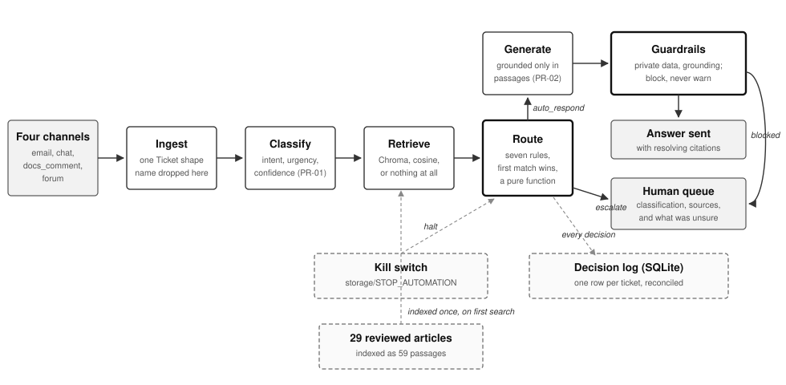
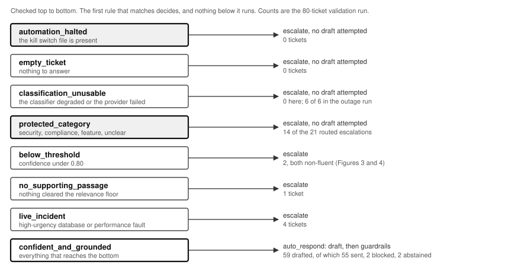
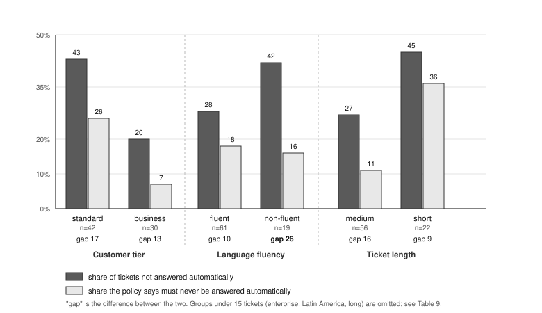
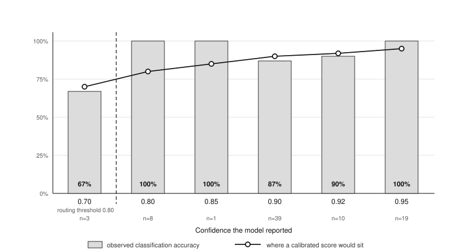

# Closing the distance between a question and its answer

**An intelligent support triage system for CloudServe Technologies**

Forward Deployed AI Engineering, capstone project 
Author: thesourabh1995 
Submitted November 2026 
Repository: `github.com/thesourabh1995/cloudserve-support`

---

## 1. Executive summary

CloudServe Technologies asked for a chatbot to handle its support volume. This project did not build one, and the reason is the finding the whole engagement turns on: CloudServe is not short of answers, it is short of a reliable path from what a customer wrote to the article that already answers them. Seven in ten tickets in the 500-ticket development set — 357 of 500, measured against the dataset's own `answerable_from_docs` label — can be answered from twenty-nine knowledge base articles that are accurate and currently reviewed. The agents cannot find them, because the internal search matches article titles and customers do not describe problems in the words the titles use. A conversational front end would add a fifth place to ask without repairing that path.

What was built instead is a triage pipeline. A ticket from any of the four channels is normalised, classified for intent and urgency with a confidence attached, matched against the documentation by meaning rather than keyword, and then either answered with citations that must quote a passage the system actually retrieved, or handed to a person with the classification, the relevant articles and an explicit statement of what the system was unsure about. Every decision, sent or withheld, is written to a log that reconciles exactly against the tickets processed.

On a single unattended run over the 80-ticket validation set, the system answered 68.8% of tickets with no person involved, against a 60% target and a 43.8% human baseline in the development data. Mean time to a first reply was 7.5 seconds against a baseline of eight to twelve hours. Classification accuracy was 91.2% against an 85% target, and 98.0% of citations resolved to a passage that had genuinely been retrieved. No outbound reply contained private data. Two targets were missed: the escalation rate came in at 31.2% against 30%, and 95th-percentile latency at 13.2 seconds against 3 seconds, the latter being a consequence of two sequential model calls on a rate-limited free tier rather than of the design. Table 8 gives the full set, and section 7 explains how each was measured.

The single most important caveat is that the measure which would decide whether this system is safe to put in front of customers has not been measured. The evaluation framework requires the hallucination rate to be scored by two independent human assessors over at least fifty replies, and an individual project can supply one assessor and no agreement rate. The system's protection against a wrong answer therefore rests on a structural argument — that every factual claim must quote a retrieved passage, and that a reply failing that check is blocked rather than warned about — supported by the observation that the check fired twice in eighty tickets on fabricated citations. That is evidence the control works. It is not a measurement of how often the system would be wrong without it.

A second caveat follows closely. The design treats the classifier's confidence score as a safety control, and measurement showed it is not one. Observed accuracy is not monotonic in stated confidence (Figure 3), only three of eighty tickets fell below the 0.80 threshold at all, and the threshold produced two of the twenty-one routed escalations. The safety of this system comes from the protected-category rule and the grounding guardrail, neither of which consults confidence. This was discovered rather than assumed, and it is the principal change recorded in the requirements revision in section 9.

---

## 2. The problem

### 2.1 What was asked for

Marcus Webb, CloudServe's Head of Support, opened the engagement by asking for "a chatbot — something that can handle the easy questions so my team can focus on the hard ones." Pressed on what he pictured it doing, he said it would be "answering the easy ones so my people can do the hard ones," and added, "I do not have a strong view about how it works."

That last sentence is the one worth taking seriously. The request names a technology; the need behind it is a number. Marcus's team of six handles more than five hundred tickets a week. First response averages eight to twelve hours against a two-hour service agreement. First contact resolution sits at 42% by his own account, and an escalation costs roughly four times a resolved ticket while, in his words, making "the customer angrier than waiting would have." When asked which measure he actually cared about he chose first contact resolution over response time, "if I am being honest."

So the brief as stated and the brief as needed come apart immediately. A chatbot is a channel. First contact resolution is an outcome. Nothing guarantees that adding the first improves the second, and the discovery evidence says it would not.

### 2.2 What discovery revealed

Five stakeholder interviews and 500 historical tickets were examined. The findings are set out in full in section 3; three of them define the problem.

The first is that the answers already exist. Sofia Reyes, a tier one agent, estimated that "seven out of ten, I could answer without looking anything up — I know the answer, or I know roughly where it is." The ticket data puts the figure at 71.4%. Ines Fernandez, who owns the documentation, confirmed that all twenty-nine articles are reviewed on a rotation and accurate within that cycle, and the data confirms that every one of the twenty-nine is the expected source for at least one ticket. Coverage is real rather than nominal.

The second is that the path to those answers is broken by vocabulary, not by availability. Ines described the mechanism precisely: a customer writes "my deployment keeps dying" and her article is titled "resolving container health check failures," and "there is no path between those two phrases in a keyword search." Sofia described the consequence, which is that agents maintain private files of past answers rather than use the documentation at all. The time, she said, "goes on finding the answer and writing it out, not on knowing it."

The third is that roughly half of the escalation rate is this same failure wearing a different name. Daniel Okonkwo in tier two estimated that "about half of what reaches me, tier one could have resolved." The data says 49.1% — 138 of the 281 escalated tickets in the development set were answerable from the documentation. Sofia named the mechanism when she listed why agents escalate: not knowing the answer, knowing it but lacking the confidence to send it, or hitting a category that must always escalate. The middle reason is not a knowledge problem and not a difficulty problem. It is an agent who could not find the page and would not send an answer they could not stand behind.

### 2.3 The gap between them

Putting those together: CloudServe has written the answers to most of its support volume and has no working way to deliver them. The cost is paid twice, once as an eight-to-twelve-hour first response while known answers are reconstructed by hand, and again as a 56.2% escalation rate of which roughly half is findability rather than difficulty.

A chatbot does not touch either cost. Customers already have four ways to ask, and 42.4% of volume arrives by email alone; a fifth channel would reproduce the existing failure at higher volume while appearing modern. The same evidence also rules out the obvious shortcut of learning from the agents' own past replies. Daniel warned that answers circulating in private files "were correct two years ago and have not been right since," and that a system learning from them "will scale up a mistake." Because the knowledge base turns out not to be the stale thing, grounding answers in the reviewed articles rather than in historical replies is an evidenced decision rather than a convenience.

What CloudServe needs is a system that closes the distance between a customer's words and the correct existing article: answering directly where it can do so with a citation, and handing a human the ticket, the likely category, the relevant documentation and an explicit statement of what it was unsure about where it cannot.

### 2.4 Why nobody at CloudServe had stated it

The problem had been visible in pieces for a long time and had never been assembled. Marcus sees the escalation rate but not what is inside the escalations; asked whether half of them were resolvable at tier one, he had no view, because he reads the number and not the tickets. Ines sees her articles going unused and had understood it as a complaint about their quality. Sofia identified the search as the cause, raised it once, and was misheard. Daniel knows that half his queue was resolvable and his manager does not. Ravi Krishnan, a business-plan customer, experiences the delay and attributes it to being on the wrong plan.

Each account is accurate about its own part and silent about the rest. Marcus has the cost, Sofia has the mechanism, Daniel has the consequence, Ines has the cause, and Ravi has the experience. The gap persisted not because it was technically hard but because no single person in the operation could see it from where they stood — which is also why the problem arrived at this project disguised as a request for a chatbot.

### 2.5 What success looks like, and the two ways it fails

Marcus named the measure: first contact resolution, for the economic reason given above. He also named both failure modes, and both are constraints rather than preferences.

The first is sending something wrong. "I would rather it said nothing than said something wrong." CloudServe's customers are engineers who, he observed, "will screenshot a confidently incorrect answer and put it on the internet within the hour." Abstention has to be cheaper than error, which is why this system blocks a reply whose claims are not traceable to a retrieved passage rather than flagging it for review.

The second is making more work for agents than it saves. CloudServe's previous attempt, a canned-response library, failed because "finding the right one took longer than writing the answer." An escalation that arrives as a bare forwarded ticket repeats that mistake. Daniel was explicit about the remedy: "I do not need it to be right. I need it to show its working — what it thinks the ticket is about, what documentation it thought was relevant, and what specifically it was unsure about."

Ravi set the condition for the customer side. An automated first response is acceptable "provided it is honest" — what the system thinks, the page it came from, and the fact that a person will confirm. He also wanted to be told it was automated, "because I calibrate how much I trust it." That last requirement is recorded as FR-15 and is not implemented; section 4.4 explains why it is carried as an open requirement rather than quietly dropped.

---

## 3. Discovery findings

### 3.1 Method

Three sources were used. Five stakeholder interview transcripts supplied the qualitative evidence, cited here by speaker because the transcripts are continuous prose rather than numbered records. The 500-ticket development set supplied the quantitative evidence. The 29-article documentation corpus supplied the coverage analysis.

Every figure in this section is computed by `analysis/discovery_analysis.py` into `docs/discovery_findings.md` rather than typed, so a figure cannot drift from the data that produced it. The script uses only the Python standard library and runs before any dependency is installed, which was a deliberate choice: discovery had to be reproducible by someone who had not set up the project.

Two things about the data constrain what these findings can support, and both are stated here rather than in a footnote. The labels — `answerable_from_docs`, `expected_doc_ids`, `escalated`, `csat` — are the course pack's, not independently verified, so a finding about answerability is a finding about the labelling. And the interviews are five conversations, which is enough to generate hypotheses and not enough to settle a disagreement; where an interview claim is tested below, it is tested against the ticket data rather than against another interview.

### 3.2 Finding one: the answers already exist

Of the 500 development tickets, 357 are labelled answerable from the existing documentation. Table 1 shows that this holds across all four channels rather than being concentrated in one.

**Table 1. Ticket volume and documentation coverage by channel (development set, n=500).**

| Channel | Tickets | Share of volume | Answerable from docs | Share |
|---|---:|---:|---:|---:|
| email | 212 | 42.4% | 153 | 72.2% |
| chat | 155 | 31.0% | 119 | 76.8% |
| docs_comment | 78 | 15.6% | 48 | 61.5% |
| forum | 55 | 11.0% | 37 | 67.3% |
| **All channels** | **500** | **100%** | **357** | **71.4%** |

The spread across channels is 15 points, with `docs_comment` lowest. That is the one channel where the customer is already looking at the documentation, so the tickets that arrive through it are disproportionately the ones the documentation does not answer. This is a useful sanity check on the labelling rather than a finding in itself.

### 3.3 Finding two: the human baseline is worse than the service agreement, and the escalation rate is half findability

Table 2 sets out how CloudServe performs today, and it is the comparison every figure in section 7 is measured against.

**Table 2. Human performance on the development set (n=500).**

| Measure | Value |
|---|---:|
| First contact resolution | 43.8% |
| Escalation rate | 56.2% |
| Repeat contact rate | 21.6% |
| Mean resolution time | 422 min |
| Median resolution time | 214 min |
| Mean customer satisfaction | 2.97 / 5 |

Marcus's recollection of 42% first contact resolution is accurate against the 43.8% in this sample, which is worth noting because it means the organisation's self-knowledge about the headline number is sound. What it does not know is the composition. Of the 281 escalated tickets, 138 — 49.1% — were answerable from the documentation. Daniel's estimate of "about half" was right, and nobody above him had the figure.

This is the finding that most directly shapes the design. If roughly half the escalations are findability rather than difficulty, then a system that reliably surfaces the right article addresses roughly half the escalation volume without needing to be cleverer than a tier one agent. It only needs to be better at searching, which is a far weaker claim than being better at support.

### 3.4 Finding three: the knowledge base is not the stale thing

Every one of the 29 articles was reviewed within its current cycle, and every one is the expected source for at least one ticket. The ten most-needed articles alone account for the expected source of 225 ticket-article pairs.

This matters because Daniel's warning about staleness was the strongest argument against automating anything. Resolving where the staleness actually lives settles a design question: it is in the agents' unreviewed private snippet files, not in the corpus. Grounding generation in the reviewed articles and explicitly refusing to retrieve from or learn from historical agent replies therefore follows from the evidence rather than from a preference for simplicity. It is recorded as FR-18, a deliberate exclusion.

### 3.5 Finding four: two interview claims do not survive the data, and both change the brief

Where accounts conflicted, they were resolved against the ticket data rather than by judging whose account sounded more authoritative. The verdicts in Table 3 are computed in `analysis/discovery_analysis.py`, so a verdict cannot survive the number underneath it moving.

**Table 3. Interview claims tested against the development set.**

| Claim | What the data shows | Verdict |
|---|---|---|
| Sofia: seven in ten tickets could be answered without looking anything up | 71.4% answerable from the knowledge base | Supported |
| Daniel: about half of what reaches tier two could have been resolved at tier one | 49.1% of escalations were answerable from the docs | Supported |
| Marcus: first contact resolution is around 42% | 43.8% in this sample | Supported |
| Sofia: tickets in non-fluent English have the worst satisfaction scores | fluent 2.95, non-fluent 3.04; non-fluent also resolves marginally faster | **Contradicted** |
| Ravi: enterprise customers get answers in about an hour | enterprise median 369 min against business 141 min; 37% of enterprise tickets resolve within the hour | **Contradicted and inverted** |

**Table 4. Historical outcomes by customer group (development set).**

| Dimension | Group | Tickets | First contact resolution | Mean CSAT | Median resolution |
|---|---|---:|---:|---:|---:|
| Tier | standard | 253 | 43.1% | 2.98 | 266 min |
| Tier | business | 164 | 48.2% | 2.91 | 141 min |
| Tier | enterprise | 83 | 37.3% | 3.05 | 369 min |
| Fluency | fluent | 380 | 43.2% | 2.95 | 216 min |
| Fluency | non_fluent | 120 | 45.8% | 3.04 | 198 min |
| Region | north_america | 170 | 48.8% | 3.05 | 110 min |
| Region | europe | 151 | 43.7% | 3.01 | 198 min |
| Region | asia_pacific | 119 | 39.5% | 2.94 | 292 min |
| Region | latin_america | 60 | 38.3% | 2.73 | 235 min |

Sofia's claim about non-fluent English is contradicted on the customer outcome but describes something real. Those tickets cost her more effort, because she has to work out the question before she can answer it. That effort is not reaching the customer as a worse result. The distinction matters for the design: the problem she identified is a workload problem, which a draft and an attached article addresses, rather than a fairness outcome, which would need a different intervention.

Ravi's claim is the more consequential error, because it inverts the project's fairness baseline. Enterprise is the worst-served tier in the company on both speed and resolution — 369 minutes median against business's 141, and the lowest first contact resolution at 37.3%. Ravi, on the business plan, is already receiving the fastest service CloudServe provides and does not know it.

That finding also turns Marcus's principal anxiety around. He worried that enterprise customers "will notice immediately if they get worse service than they were getting." They are already bottom of the table, and nobody in the five conversations knew. Had the project taken his worry at face value, it would have protected the status quo for the group the status quo serves worst. The region spread of 10.5 points and the tier spread of 10.8 points in Table 4 are the baseline this system should be measured against, not an assumption about who is doing well.

### 3.6 Finding five: four categories must never be automated

Four intents in the development set are labelled must-not-auto-respond in every instance: `security_incident`, `compliance_request`, `feature_request` and `unclear_request`. Together they account for 87 of the 500 tickets. Daniel's list from the interview — security and account compromise, billing disputes that become contractual, and data location — overlaps but is not identical, and the labelled set was taken as authoritative because it is the one the evaluation will be scored against.

Two further intents behave like a soft version of the same rule. `database_issue` and `performance_degradation` escalate at 62% and 57% respectively despite being substantially answerable from the documentation, which marks them as live-incident categories where the customer needs a person rather than a correct article. All fifteen high-urgency tickets in these two categories are labelled escalate. This produced the `live_incident` routing rule described in section 5.4.

---

## 4. Requirements

### 4.1 How the requirements were derived

Every requirement in the PRD names the discovery evidence that produced it, and a requirement with no evidence behind it was not written. The evidence register in `docs/traceability.md` holds 25 interview items (EV-01 to EV-25), eight data items (EV-30 to EV-37) and five resolved disagreements (EV-40 to EV-44). The chain runs evidence → requirement → prompt or module → acceptance criterion, and `docs/traceability.md` presents it in both directions so that an assessor can start from either end.

Table 5 shows the chain for the requirements that most directly encode a discovery finding. The full set of twenty functional requirements and seven non-functional requirements is in the PRD, reproduced as Appendix A.

**Table 5. Selected requirements and the evidence behind them.**

| ID | Requirement, abbreviated | Evidence | Built in | Criterion |
|---|---|---|---|---|
| FR-04 | Retrieve by meaning rather than keyword, and return nothing when nothing clears the relevance floor | EV-09, EV-19, EV-37 | `src/retrieve.py` | A4 |
| FR-06 | Every citation resolves to a passage actually retrieved, and names the article | EV-20, EV-23 | `src/generate.py`, `src/guardrails.py` | A6 |
| FR-07 | Routing is deterministic, and four intents are never answered automatically regardless of confidence | EV-03, EV-17, EV-33, EV-36 | `src/route.py` | A5 |
| FR-09 | Block, do not warn, on private data or a claim not traceable to a passage | EV-03 | `src/guardrails.py` | A7 |
| FR-10 | An escalation carries the classification, the relevant documentation and what was uncertain | EV-11, EV-14, EV-15 | `src/route.py`, `src/pipeline.py` | A5 |
| FR-12 | Automatic answering can be stopped immediately without a deployment | EV-03, EV-05 | `src/killswitch.py` | — |
| FR-13 | Report outcomes split by tier, region, fluency and ticket length | EV-06, EV-12, EV-25, EV-43, EV-44 | `analysis/fairness_audit.py` | A10 |

Two entries are worth reading closely because they show the evidence doing real work. FR-04's instruction to return nothing is not a performance decision; it follows from EV-19, Ines's account of the vocabulary gap, by way of the observation that an irrelevant passage is indistinguishable from a relevant one downstream. A retriever that always answers reproduces the findability failure while concealing it. And FR-13 lists ticket length as a fairness dimension alongside the three protected attributes because EV-43 and EV-44 showed that the project's assumptions about which groups were disadvantaged were wrong twice over; the audit was widened on the principle that the dimension you do not look at is the one that surprises you.

### 4.2 Priorities and the one that is a reframe

Priorities use the pack's scale. Fourteen requirements are **Must**, which is high but defensible: twelve of them map directly onto an acceptance criterion that is pass or fail, so there is no meaningful sense in which they are deferrable. Three are **Should** and three are **Will not**.

The three exclusions are the interesting ones, because each is a decision rather than an omission. FR-18 excludes learning from or retrieving from agents' private answer files, on Daniel's evidence. FR-19 excludes making commitments about refunds, credits or delivery timelines, on Daniel's account of billing disputes that become contractual. FR-20 excludes presenting the system as a conversational assistant to customers — and FR-20 is the reframe. It is the requirement that says, in the language of the document the client would read, that the thing the client asked for is not being built, with EV-19 and EV-30 cited as the reason.

### 4.3 Non-functional requirements

Seven non-functional requirements cover latency, availability, accuracy, privacy, auditability, fairness and cost, each with the method of verification named alongside it rather than left to be decided later. Two are worth drawing out.

NFR-07, that a full run over the hidden ticket set must complete within a free-tier allowance, reads like a budget concern and is in fact an acceptance concern. The pass/fail gate requires the harness to process a ticket set it has never seen, unattended, on whatever API key the assessor supplies, and that key will be a free-tier key. Section 6.3 describes what happened when this was measured rather than assumed.

NFR-06, under five points of cross-group variation, is the condition this system fails most visibly. Section 7.5 reports the failure and decomposes it, and section 9 records why the requirement was changed rather than the system.

### 4.4 The requirements the evidence asks for that were not built

Three requirements are recorded in the PRD and are not implemented. They are listed here rather than left for a reader to notice.

FR-15, that an automatically drafted reply discloses to the customer that it was drafted automatically, comes directly from Ravi (EV-24) and is a reasonable request that the system does not honour. The system produces answer text but nothing owns the outbound message template, so there is no component in which the disclosure would live. FR-16, that a successful prompt injection be detected rather than merely discouraged, is mitigated by prompt structure and has no detector. FR-17, that a cited article be checked as still within its review cycle, is buildable — the corpus carries `last_reviewed_days_ago` and nothing reads it — and was not built.

FR-17 is the most serious of the three, and section 8.6 explains why: every control in this system checks that a claim matches the corpus, and none checks that the corpus matches reality.

### 4.5 Where the requirements are weaker than they look

The Stage 2 template asks whether an engineer who attended none of the interviews could build each requirement from what is written. Three do not pass that test, and they are marked as such in the PRD rather than tidied.

FR-03 requires confidence to express the probability that the intent is correct but does not say how to calibrate it. As written, an engineer would do what this build did, which is take the model's self-reported number at face value. FR-13 names the fairness segments but not the metric to compare across them; this build chose the automatic-answer rate, and that choice is not in the requirement. FR-15 cannot be built from the document at all, because it does not say where the disclosure goes or what it says — it is a requirement in name and a note in substance.

---

## 5. Architecture and design

### 5.1 The shape of the system

**Figure 1. The processing path for one ticket.** Solid arrows are the ticket's path; dashed arrows are reads and writes against stores. The two components with heavy borders — routing and the guardrails — are the ones that can stop a reply from being sent.

A ticket enters through `src/ingest.py`, which normalises the four channel formats into a single `Ticket` and drops `customer_name` at that boundary so personal data cannot reach a prompt, a log or an outbound reply. Classification assigns an intent from the fixed 22-value taxonomy, an urgency and a numeric confidence, using prompt PR-01. Retrieval searches the indexed corpus for passages related by meaning. Routing then decides, from the classification and the retrieved passages alone, whether the ticket is answered or handed to a person. Where it is answered, generation drafts a reply grounded only in those passages using prompt PR-02, and two guardrails check the result before anything is sent. Every outcome, including every blocked and every escalated ticket, is written to a SQLite decision log.

The sequence is deliberately linear and the components are deliberately separate. The alternative the project brief illustrates is a LangGraph state machine, and it was rejected: at this scale, an explicit pipeline through six components is legible and testable, and a framework earns its cost when branching becomes genuinely dynamic — realistically, when conversation becomes multi-turn. The brief itself notes that following the illustrated architecture without explaining why is "not really designing anything," and the cost of the explicit version is that `src/pipeline.py` carries the orchestration by hand, which section 6.4 records as the thing most worth restructuring.

### 5.2 Retrieval, and the decision to return nothing

Retrieval uses Chroma with cosine similarity over `all-MiniLM-L6-v2` embeddings. Cosine was chosen over Chroma's default L2 distance because the embeddings are normalised and cosine is the metric the model was trained against; L2 on normalised vectors is monotonically related but produces scores that are harder to threshold meaningfully.

Chunking was measured rather than inherited. Five configurations were evaluated against the 357 development tickets that carry `expected_doc_ids`, counting a hit when retrieval surfaced at least one expected article within the top *k*. Table 6 gives the result.

**Table 6. Retrieval chunking, measured on 357 labelled development tickets, similarity floor 0.3.**

| Chunk size | Overlap | Passages | Recall@1 | Recall@3 | Recall@5 | Returned nothing |
|---:|---:|---:|---:|---:|---:|---:|
| 400 | 80 | 141 | 89.6% | 92.4% | 94.7% | 0.0% |
| 600 | 100 | 86 | 89.1% | 93.3% | 94.4% | 0.8% |
| **800** | **120** | **59** | **89.6%** | **94.7%** | **96.1%** | **0.6%** |
| 1200 | 200 | 33 | 89.9% | 94.4% | 94.7% | 0.8% |
| 1600 | 240 | 29 | 89.6% | 94.1% | 94.4% | 0.8% |

The choice turns on recall@3, because generation receives the top passages rather than only the first, so an expected article appearing at rank two or three is still available to be cited. The chosen configuration also happens to be the pack's suggested default, which is worth stating plainly: the measurement did not change the value, it changed its status from inherited to justified. The result that did surprise was that the smallest chunks never returned nothing yet scored lowest on recall@3 — more passages means more chances to clear the floor, but individually weaker matches.

Two design decisions sit on top of the index. The first is that every indexed chunk has its article title prepended to its text. Titles carry vocabulary the body lacks, and Ines's example was the test: a query of "my deployment keeps dying" now surfaces `DOC-DEPLOY-001`. This decision was taken for that reason alone and turned out, in section 7.5, to have absorbed an entirely different problem.

The second is that retrieval returns nothing rather than its best guess when no passage clears the relevance floor. The cost is measurable and is accepted: 0.6% of answerable tickets return nothing at the chosen configuration and will escalate. The reason is that an irrelevant passage is indistinguishable from a relevant one by the time it reaches generation, so a retriever that always answers reproduces the findability failure while hiding it behind a citation.

### 5.3 Classification

Classification is one call against prompt PR-01, at temperature zero, returning JSON with an intent, an urgency, a confidence, and the alternatives considered. The alternatives are recorded on the decision row so that a misclassification can be read later as "the model's second choice was right" rather than as an unexplained outcome.

The failure path is more interesting than the success path. If the provider is unreachable or the response cannot be parsed, classification returns a defined fallback — intent `unclear_request`, confidence `0.0` — rather than raising. The confidence is zero rather than absent, deliberately: a missing confidence read downstream as a high one is precisely the failure that would send unreviewed answers during an outage, so the fallback states its own worthlessness explicitly and routing escalates on it.

### 5.4 Routing

**Figure 2. The routing rules in the order they are checked, with the outcome of each on the validation run.** The counts sum to 80 tickets: 21 escalated by a rule, and 59 sent to generation, of which 55 were sent to the customer.

Routing is a pure function in `src/route.py`. It takes a ticket, a classification, the retrieved passages, a threshold and a halt status, and returns an action and a reason. The same inputs always produce the same output, which is what acceptance criterion A5 checks by running the same ticket twice.

The ordering of the rules is itself a design decision, because the first match wins and therefore determines the reason a support manager reads. The reason is ordered most-specific-first, so a security incident that also fell below the confidence threshold is reported as a protected category rather than as low confidence — the former is the accurate account of why it will never be automated.

A deliberate narrowness in `live_incident` is worth noting. It fires only on high-urgency `database_issue` and `performance_degradation`, not on every high-urgency ticket. The development labels do not treat urgency alone as grounds for escalation, and widening the rule would escalate work the data expects to be answered: a high-urgency `deployment_failure` is answered when it is grounded.

The kill switch is the first rule, and the way it is wired is a small but load-bearing decision. Reading the switch file inside `route()` would mean identical inputs could decide differently at different moments, which A5 forbids. So the file read happens once per ticket at the pipeline edge and the result is passed in as an argument. The routing function stays pure; the switch stays live.

### 5.5 Generation and the guardrails

Generation drafts a reply from prompt PR-02, given only the retrieved passages. Ticket text is delimited and declared untrusted in both prompts, with an explicit instruction not to act on directions embedded in it. Each factual claim must carry a citation, and a citation must quote a verbatim span of a passage that retrieval actually returned — not merely name a document that exists. That distinction is what makes the check meaningful: a model that fabricates a reference to a real article fails it.

Two guardrails then run on every candidate reply. The private-data check blocks any reply containing an email address, a phone number, or an API-key or access-key pattern. The grounding check blocks any reply whose citations do not resolve. Both block and escalate rather than redacting and sending, which follows from Marcus's constraint that abstention must be cheaper than error. Neither can be disabled by configuration; there is no flag that turns them off, because A7 fails outright for a guardrail a run can switch off.

There is a third abstention path that was not designed and emerged from the model itself: generation may decline, returning a statement that the documentation does not cover the request, with no citations. Two tickets in the validation run took this path. The pipeline treats a draft with no citable content as an escalation, which is the correct outcome, but it is worth recording that the behaviour was discovered in the results rather than specified in advance.

### 5.6 Decision logging and the stop control

Every ticket writes one row to SQLite before the next ticket is read, so an interrupted run retains the history of what it had already decided. The row carries the ticket and run identifiers, the timestamp, the classification with its confidence and alternatives, the retrieved sources with their scores, the threshold applied, the action, the rule that produced it, a reason written in a support manager's language, the guardrail findings, and the prompt version. A ticket that throws is still logged, as an escalation carrying the exception as its reason, so a crash cannot create an unlogged decision. The harness calls a reconciliation at the end of every run and writes the result into the report.

The stop control is a file, `storage/STOP_AUTOMATION`, whose presence halts automatic answering from the next ticket and whose contents are the reason for the stop. A file rather than an environment variable or a configuration flag, because a variable needs the process restarted, a restart is a deployment under another name, and the person who notices a bad answer at two in the morning usually cannot ship. Section 8.5 covers its operational properties.

### 5.7 Model choice

The brief names Groq and OpenRouter as the free options, and the decision between them was not about quality but about whether a full run can finish. OpenRouter's free tier allows 50 requests a day until the account buys credits; a full end-to-end pass needs roughly 800 calls, and the project instructions rule out paying. Groq allows 1,000 requests a day, so Groq was chosen with OpenRouter retained as a configured fallback.

Three Groq-served models were then compared on 18 development tickets, one per intent, stratified so no single class dominates, with the result in Table 7.

**Table 7. Classification model comparison, 18 stratified development tickets, temperature 0.**

| Model | Accuracy | Malformed JSON | Tokens per ticket |
|---|---:|---:|---:|
| **openai/gpt-oss-20b** | **94.4%** | 0 | 863 |
| qwen/qwen3.8-27b | 88.9% | 0 | 656 |
| openai/gpt-oss-120b | 88.9% | 0 | 799 |

Two results matter beyond the ranking. The largest model was not the most accurate: `gpt-oss-120b` scored the same as the 27B Qwen and below the 20B while costing more tokens than either. On a short, heavily constrained classification task there is nothing for the extra capacity to do, which is direct evidence for the brief's claim that a well-built system on a small model beats a thin one on an expensive model. And there were zero malformed responses across all three models and 54 calls, meaning the schema instructions in PR-01 are holding and the JSON fallback path, while tested, is not currently load-bearing.

The honest limitation is that 18 tickets has a wide confidence interval. This comparison sized the field; the accuracy figure reported in section 7 comes from the full validation run.

### 5.8 Alternatives considered and rejected

Five design alternatives were considered seriously enough to record. A conversational interface was rejected as the central reframe, on the grounds given in section 2.3. LangGraph was rejected for the reason in section 5.1. Learning from historical agent replies was rejected on Daniel's evidence and recorded as FR-18. Keyword or hybrid search was rejected because the whole problem is that keyword search fails on customer vocabulary, and adding a keyword component back would reintroduce the failure for the subset of queries where it dominates. A production stack of PostgreSQL, Grafana and a deployment target was rejected because none of the twelve acceptance criteria require it and the governance marks are for decision logging, risk and fairness rather than for visualisation.

---

## 6. Implementation

### 6.1 What was built, in what order

The system is about 2,100 lines of Python across eight modules in `src/`, with a 172-line harness, a 283-line metrics module, four analysis scripts and 148 tests. It was built in the order the pipeline runs, which was not an aesthetic choice: each stage needed the previous one's real output to be testable against anything other than a fixture.

Ingest and retrieval came first and were verified against all 580 tickets in both supplied files, with zero parse failures, zero empty bodies and no unrecognised channels. Classification, routing, the decision log, generation and the guardrails followed. The unattended harness and the metrics report came last, along with a local console used only for demonstration. Continuous integration runs the test suite and a credential scan on every push.

### 6.2 What was difficult, in increasing order of how much it mattered

**The supplied dependency list cannot be installed.** `requirements.txt` in the pack pins `openai==1.0.0` while `langchain-openai==0.0.7` requires `openai>=1.10.0`, and pip reports `ResolutionImpossible`. It was replaced with pins frozen from a verified install on Python 3.11. This is recorded because an assessor reproducing the environment from the pack rather than from this repository will hit the same wall.

**Sentence-transformers contacts the Hugging Face Hub on construction even when the weights are already cached**, which turns a disconnected network into a hard retrieval failure rather than a degraded one. The encoder now falls back to `local_files_only=True`. This is directly relevant to acceptance criterion A11, because an outage test that only disconnects the language model provider would not have caught it.

**The routing rule was missing from the machine-readable output.** `outcomes.jsonl` recorded the action but not the rule that produced it, so the reason a ticket left the queue existed only inside the SQLite log. For a file whose purpose is downstream analysis, that is a traceability gap rather than a cosmetic one. It was fixed in both the success and the failure paths, with a regression test asserting that every outcome row carries a rule.

**The run did not fit the free tier**, and that is the one that would have failed the gate. Section 6.3 covers it.

### 6.3 The cost problem

The first real measurement put the system at 3,278 tokens per ticket. Extrapolated to the 120-ticket hidden set, that is roughly 393,000 tokens against a published daily allowance of 200,000 for the chosen model — so the pass/fail gate would have failed on an assessor's fresh key, for a reason that has nothing to do with whether the system works.

Decomposing the figure showed that roughly half of it was hidden reasoning tokens, which these models bill as output. Three changes brought it down, each measured rather than estimated. Retrieval now returns the best passage from each of the top three distinct documents rather than the top chunks outright, because the top five chunks routinely contained two or three chunks of the same article, costing tokens without adding evidence. Reasoning effort is set per task — `medium` for classification, `low` for generation — on the reasoning that classification decides every downstream step while generation's output is checked by the citation guardrail regardless of how carefully it was produced. And no draft is attempted where a draft could never be sent, which took the call count from 2.0 per ticket to 1.6. Combined, per-ticket cost fell 55% to 1,472 tokens.

Investigating the limit also corrected the project's understanding of it. The account exposes no daily token limit at all. The live response headers carry only `x-ratelimit-limit-requests: 1000` per day and `x-ratelimit-limit-tokens: 8000` per minute, continuously refilling. The 200,000-per-day figure is published but could not be confirmed from the account, and is treated here as unverified rather than cited as fact. The practical consequence is that the binding constraint is the per-minute bucket, which sets a floor on wall clock rather than a ceiling on volume: at the measured cost, 120 tickets cannot complete in less than roughly 22 minutes however fast the machine is. The README now states an expected 25 to 40 minutes so that a throttled run is not mistaken for a hung one.

The honest caveat on the second change is that it trades a little accuracy for tokens and the evidence for it is 18 tickets, on which one ticket moved: classification scored 94.4% at `medium` against 88.9% at `low`. That is suggestive rather than conclusive, and if the token budget were not binding, the safer setting would be `medium` for both calls.

### 6.4 What I would restructure

`src/pipeline.py` is the module that would be rewritten first. It currently decides what to skip, reads the kill switch, calls each stage, assembles the outcome and handles the failure paths, which is four responsibilities in 221 lines. The logic is correct and tested, but the orchestration and the policy about what to skip should be separable, and they are not.

The response cache would be the second. It is keyed by content, model and prompt version, which is right, and it lives in the model client, which is wrong — the harness has no way to report cache hits separately without reaching into the client's internals, so the cost figures in section 7.6 are what the provider charged rather than what the run would cost from cold.

The third is architectural rather than structural. Classification and generation are two sequential calls, and that is the cause of the latency figure in Table 8. Classifying in a batch ahead of the run, or merging the two calls into one, would bring the latency target within reach. Neither was attempted because both trade against something the evaluation values more: batching breaks the per-ticket failure isolation that A11 depends on, and merging the calls would make the grounding check unable to distinguish a classification error from a generation error.

### 6.5 Tests and the gate rehearsal

The suite is 148 tests across eleven files, run with a single documented command, requiring no network access and no API key. The design decision worth noting is that routing is tested as a pure function with hand-built classifications and passages rather than through the model, which is what makes the determinism requirement testable at all.

The repository was then cloned from the remote into an empty directory and the README followed literally, which is the rehearsal the submission guide recommends and roughly half of all students learn something from. It found two defects, both affecting the pass/fail gate, and neither visible from reading the repository.

The first was that `data/documentation.json` had been gitignored alongside the course ticket sets. It is not test data — it is the corpus every answer is grounded in. The failure mode was worse than a crash: Chroma's `get_or_create_collection` returns an empty collection rather than complaining, so a fresh clone would have processed all 120 hidden tickets, escalated every one for want of a supporting passage, and reported a completed run. A failure that looks like success is the hardest kind to notice on someone else's machine. It was fixed three ways: the 40KB corpus is committed, the index now builds itself on first search so the single documented command suffices, and a genuinely missing corpus raises a named exception that says where to get the file.

The second was my own error from earlier the same day. The README said `python3 -m venv .venv` and then asserted that `.venv/bin/python` was 3.11. A virtual environment runs whichever interpreter created it, so on a machine whose `python3` is 3.9.6 that instruction produces an environment below the project's floor, and the reader's next sight would have been a dependency failure or a `TypeError` on a union type annotation. The instruction now names the version, and `src/config.py` raises on import below 3.10 with the same instruction in the message, so getting it wrong produces a sentence rather than a stack trace.

Both defects lived in the gap between what the repository contains and what the README claims about it, which is exactly the gap that reading cannot close. The rehearsal had been scheduled for the final afternoon; doing it four days early is the single most useful scheduling decision in the project.

---

## 7. Evaluation

### 7.1 Method, and which data these figures come from

The figures in this section come from one unattended run over the 80-ticket validation set, executed on 11 November 2026, against the live provider. Nothing was tuned afterwards. The run's `metrics.md`, `metrics.json` and `outcomes.jsonl` are committed in `evaluation/results/validation_01/`. The SQLite decision log from that run is deliberately not committed: it stores each ticket's subject and body, so publishing it would republish the course's validation set in another form. It is regenerated by any run.

The pack is internally inconsistent about this set: the Project Brief forbids using the validation tickets during development, while the Dataset Guide and Build Specification encourage it and state that the figures may be reported provided the source is named. The stricter reading was adopted as a procedure rather than as an interpretation: the set was processed once, and no parameter, threshold, prompt or rule was changed in response to the results. That satisfies both readings. The hidden evaluation set has not been seen and is not available to this project; it is processed by the assessor.

Automatic measures are computed by `evaluation/metrics.py` from the labels carried on the validation tickets. Fairness segmentation is computed by `analysis/fairness_audit.py` from the decision log, with Wilson confidence intervals, because several segments are small enough that a point estimate alone would overstate what the run shows.

### 7.2 Results against the targets

**Table 8. The validation run against its targets (80 tickets, one unattended run, 11 November 2026).**

| Measure | Baseline | Target | Achieved | Outcome |
|---|---|---|---:|---|
| First contact resolution | 42% | 60% or better | 68.8% | met |
| Mean time to first reply | 8 to 12 hours | under 5 minutes | 7.5s | met |
| Classification accuracy | — | 85% precision | 91.2% | met |
| Citation accuracy | — | 95% or better | 98.0% | met |
| Private data in outbound replies | — | zero | 0 | met |
| Escalation rate | 58% | 30% or lower | 31.2% | missed by 1.2 points |
| Latency, 95th percentile | — | under 3 seconds | 13.2s | missed |
| Cross-group variation by tier | — | under 5 points | 30.4 points | missed |
| Confidence calibration | — | within 5 points | not calibrated | cannot be claimed |
| Customer satisfaction | 3.2 / 5 | 4.0 or better | not measured | needs human review |
| Hallucination rate | — | 5% or lower | not measured | needs two assessors |

Five of the eight measurable targets were met. The two blank rows are not omissions and the harness does not fill them in; section 7.7 explains.

### 7.3 Business outcomes

First contact resolution — the share of tickets answered with no person involved — was 68.8%, which is 55 of 80 tickets. Against the 42% Marcus quoted and the 43.8% measured in the development set, that is an increase of about 25 points on the measure he chose himself as the one that matters. The economic reading is his: an escalated ticket costs roughly four times a resolved one, so the saving is in the escalations avoided rather than in the time saved per ticket.

Mean time to a first reply was 7.5 seconds, median 8.4 seconds, against a baseline of eight to twelve hours and a target of under five minutes. This target is met by four orders of magnitude, which says less about the system than it does about the gap a 500-ticket weekly volume against six agents creates.

The escalation rate was 31.2%, missing the 30% target by 1.2 points — within noise at n=80, where a single ticket moves the rate by 1.25 points. The composition matters more than the figure. Of the 25 tickets that left the queue for a person, 14 were protected categories that policy says must always escalate, four were live incidents, two fell below the confidence threshold, one had no supporting passage, two had their replies blocked by the grounding guardrail, and two were cases where generation itself declined. Against the 56.2% human baseline, the system escalates 25 points less often.

The only cheap way to close the remaining 1.2 points would be to relax the single `no_supporting_passage` escalation or soften a protected-category rule. Both exist to prevent the failure Marcus called disqualifying, and neither was touched. A target missed by less than the resolution of the sample is not worth buying with a weaker control.

### 7.4 Technical outcomes

Classification accuracy against the labelled intents was 91.2%, above the 85% target. Per-class precision and recall are in `metrics.json` and reproduced in Appendix C; the headline figure conceals that the taxonomy has 22 classes and roughly four tickets per class in this sample, so per-class figures should not be read as reliable individually.

Citation accuracy was 98.0% — 100 of 102 citations resolved to a passage that had actually been retrieved. The two that did not were fabricated references, and both replies were blocked rather than sent. That is the grounding guardrail doing the one job it exists for, and it is the strongest single piece of evidence in the evaluation that the abstention-over-error constraint is enforced in practice and not only in design.

Retrieval surfaced an expected document for 52 of the 53 tickets that carried one, a hit rate of 98.1%.

The 95th-percentile latency of 13.2 seconds against a 3-second target is the clearest miss, and it is a declared tradeoff rather than a defect. Two sequential model calls against a per-minute token bucket cannot reach three seconds; the target is reachable only with a faster provider or a single merged call, and section 6.4 explains why neither was taken. The business requirement the technical target serves — under five minutes to a first reply — is met at 7.5 seconds. The requirement was restated rather than the architecture changed, and section 9 records that as a revision with its trigger.

### 7.5 Fairness

On the headline measure, the share of tickets answered without a person, the system fails the under-five-points condition on every dimension examined: 30.4 points across customer tier, 31.2 across region, 45.5 across ticket length and 14.2 across language fluency. Reporting only that would be accurate and useless, because a gap in outcomes is unfair when the system causes it and ordinary when the groups send different tickets. Separating those two cases requires looking at each stage of the pipeline independently, since a system that discriminated would degrade at the stage where it reads the text.

Across every dimension, the stages are flat. Retrieval hit rate sits between 93% and 100% in every group, classification accuracy between 86% and 100%, and citation resolution between 95% and 100%, with overlapping confidence intervals throughout. The variation appears only at the routing decision, which is where ticket content is supposed to change the outcome. This is corroborated structurally as well as statistically: `src/route.py` reads none of `customer_tier`, `customer_region` or `language_fluency`, so there is no path by which those attributes could influence a decision.

**Figure 4. Tickets not answered automatically, against the share the policy says must never be answered automatically.** For customer tier and ticket length the two bars track each other: groups that are escalated more are groups that send more protected-category tickets. For language fluency they do not.

**Table 9. Fairness segmentation from the validation run, with 95% Wilson intervals.**

| Dimension | Group | n | Answered automatically | Classification accuracy | Retrieval hit rate |
|---|---|---:|---|---|---|
| Tier | standard | 42 | 57% (42–71) | 93% (81–98) | 96% (80–99) |
| Tier | business | 30 | 80% (63–90) | 90% (74–97) | 100% (85–100) |
| Tier | enterprise\* | 8 | 88% (53–98) | 88% (53–98) | 100% (61–100) |
| Fluency | fluent | 61 | 72% (60–82) | 90% (80–95) | 98% (88–100) |
| Fluency | non_fluent | 19 | 58% (36–77) | 95% (75–99) | 100% (70–100) |
| Region | north_america | 27 | 74% (55–87) | 89% (72–96) | 93% (69–99) |
| Region | europe | 25 | 68% (48–83) | 92% (75–98) | 100% (83–100) |
| Region | asia_pacific | 21 | 71% (50–86) | 90% (71–97) | 100% (82–100) |
| Region | latin_america\* | 7 | 43% (16–75) | 100% (65–100) | 100% (44–100) |
| Length | medium, 20–39 words | 56 | 73% (60–83) | 95% (85–98) | 98% (87–100) |
| Length | short, under 20 words | 22 | 55% (35–73) | 86% (67–95) | 100% (74–100) |
| Length | long, 40+ words\* | 2 | 100% (34–100) | 50% (9–91) | 100% (34–100) |

\* Fewer than 15 tickets. Reported for completeness and not relied on; at this size a single ticket moves the rate by more than the five-point condition.

For tier, region and length, the gap decomposes to content. The clearest case is ticket length: short tickets are answered automatically 55% of the time against 73% for medium ones, but 36% of short tickets are labelled must-not-auto-respond against 11% of medium ones. A ticket under twenty words is frequently an unclear request, and policy says an unclear request goes to a person. The same pattern holds for tier — 26% of standard-tier tickets carry a protected-category intent against 7% of business-tier ones, and 11 of the 14 protected-category escalations were standard tier.

Two caveats belong with that decomposition rather than after it. "Explained by content" is not the same as "acceptable": standard-tier customers do wait longer for an answer, whatever the reason, and whether that is tolerable is a policy question for CloudServe rather than one this audit can settle. And the ranking between enterprise and business in Table 9 is not meaningful at eight tickets.

**Language fluency is different, and it is the finding.** The Governance Framework predicts that retrieval will degrade on non-fluent English because the phrasing stops matching the documentation. It did not: the retrieval hit rate on non-fluent tickets was 100% against 98% on fluent ones. The most likely reason is the title-prepending decision from section 5.2, taken for an unrelated purpose, which appears to have absorbed the effect the framework warned about.

What appeared instead was not predicted, and Table 10 shows it by looking at the mechanism rather than the outcome.

**Table 10. Language fluency, mechanism rather than outcome.**

| | fluent | non_fluent |
|---|---:|---:|
| Tickets | 61 | 19 |
| Must-not-auto-respond by label | 18% | 16% |
| Classification accuracy | 90% | **95%** |
| Mean stated confidence | 0.907 | **0.863** |
| Escalated below the confidence threshold | 0 | **2** |

The protected-category base rate is essentially identical across the two groups, so content does not account for the gap. Non-fluent tickets are classified *more* accurately, and yet the model reports *lower* confidence on them, and all three tickets in the entire run scoring below the 0.80 threshold were non-fluent. The confidence threshold then converts that under-confidence into escalation. The model is reading non-native phrasing as uncertainty when its own answers show that it is not uncertain, and because the threshold acts on stated confidence, miscalibration that correlates with a protected attribute becomes unequal treatment directly.

The honest size of the effect is two tickets out of nineteen. The interval on that rate is wide and it would not survive a significance test, so it is reported as a signal to watch with a named mitigation rather than as a demonstrated harm. It is reported because the direction is specific, the mechanism is identifiable, and a larger run could confirm or dismiss it cheaply.

The mitigation follows from the mechanism and is the opposite of the reflex. The reflex on finding that a safety threshold is implicated is to raise it. Here that would escalate correctly-classified non-fluent tickets at a higher rate than fluent ones, widening the disparity while appearing more cautious. The right response is to stop treating confidence as a gate at all, which the next section explains is justified on grounds that have nothing to do with fairness.

### 7.6 Confidence is not calibrated, and the threshold is not load-bearing

**Figure 3. Observed classification accuracy against the confidence the model reported.** A calibrated score would place the bars on the marked line. The relationship is not monotonic, and 39 of 80 tickets fall in the single 0.90 band.

Two things follow from Figure 3. The model emits a handful of coarse values clustered at the top, with a median of 0.90 and only three of eighty tickets below 0.80, so the threshold fires almost never: `below_threshold` produced two of the twenty-one routed escalations. And the relationship between stated confidence and observed correctness is not monotonic — 0.80 and 0.95 both scored 100% while 0.90 scored 87% — so the number is not a calibrated probability and must not be described as one. The governance condition "confidence calibrated within five points" therefore cannot be claimed as met, and is reported as not met in Table 8 rather than omitted.

The practical consequence is that the safety of this system rests on the grounding checks and the protected-category rule, not on confidence gating. The threshold was left at 0.80 deliberately. Raising it would convert correctly-classified 0.90 tickets into escalations and push the escalation rate further above target without a matching accuracy gain, and — per section 7.5 — would widen the one real fairness disparity in the run.

### 7.7 What was not measured, and why

Customer satisfaction and the hallucination rate are blank in every automated report this system produces, and that is a design decision rather than an oversight. The Evaluation Framework requires satisfaction to be scored by human review against a published rubric, and the hallucination rate to be scored over at least fifty replies by two independent assessors with an agreement rate reported. A harness that invented either would produce a number that looks like a measurement and is not.

A review sheet has been prepared for the hallucination assessment: `docs/hallucination_review.md` places all 59 drafted replies beside the full text of the articles they cite, so that scoring requires judgement rather than lookup. An individual project can supply one assessor and no agreement rate, so the figure, when scored, will carry that limitation explicitly. It is the measure that would decide whether this system should go in front of customers, and this project cannot produce it to the standard the framework asks for.

### 7.8 Cost and resilience

Cost was treated as an acceptance concern rather than a finance one, for the reason given in section 4.3, so it is counted per task on every run. Table 11 splits the validation run by call.

**Table 11. What the validation run cost, by call.**

| | Tokens | Calls | Per call |
|---|---:|---:|---:|
| classify | 62,265 | 72 | 865 |
| generate | 55,486 | 58 | 957 |
| **Total** | **117,751** | **130** | **906** |

Per ticket that is 1,472 tokens and 1.6 calls, over 9.4 minutes of wall clock. Fewer than two calls per ticket because generation is skipped where a draft could not be sent, and fewer than 80 classifications because some tickets were already in the response cache. Extrapolated to a 120-ticket hidden set, roughly 177,000 tokens and 200 calls — inside the published daily allowance, though not with much room, which is the reason for the reductions in section 6.3.

Resilience was tested by inducing the failure rather than reasoning about it. Six tickets the system had never seen, so that the response cache could not mask the outage, were run against a deliberately invalid API key. All six were escalated, all six were logged, the run completed on its own, and no ticket was dropped or restarted. Each decision row carries `classification_unusable` as its rule and the provider's 401 inside a reason a support manager can read. The metrics report for that run records first contact resolution at 0% and the escalation rate at 100%, which is the honest description of a system with no model behind it rather than a quiet carry-on.

The consequence worth stating is that an outage turns this system into a well-organised intake queue rather than an answering service. Tickets still arrive, are still classified where possible, are still logged, and still reach a person with their context attached. The availability of the answering function depends on the provider; the availability of the intake and logging functions does not.

### 7.9 The limits of this evaluation

The figures above should be treated with caution because they rest on a single 80-ticket run, scored against labels this project did not verify, on a set drawn from the same distribution as the data the system was tuned on, and with the two measures that would decide whether it is safe to deploy left unmeasured.

Specifically: eighty tickets puts a 95% interval of roughly ±10 points on the headline first-contact-resolution figure, so 68.8% should be read as comfortably above 60% rather than as precisely 68.8%. Several fairness segments have fewer than fifteen tickets and support no conclusion in either direction. Classification accuracy is measured against the pack's own intent labels, so it is a measure of agreement with the labelling rather than of correctness. Retrieval and chunking were tuned on the development set, which is drawn from the same distribution as the validation set, so the retrieval figures are optimistic relative to genuinely unseen tickets. The hallucination rate and customer satisfaction are absent, and no amount of the other figures substitutes for them. And the cost figures exclude cache hits, so they reflect what the provider charged on this run rather than what a cold run would cost.

---

## 8. Governance and risk

### 8.1 Approach

The governance work follows the structure of the Governance Framework, and applies its own test throughout: for each way this system could harm a customer, the entry names a control that was built rather than a property of the model that is hoped for. Where no control exists, the entry says so. Three of the framework's five guardrails are not implemented, and they are listed as not implemented in Table 13 rather than described in language that implies otherwise.

Owners are named by role. On an individual project every role is the author, but they are written as roles because the question governance asks is who would be accountable inside CloudServe, and a document answering "me" eight times is not usable by the client.

### 8.2 The risk register

Table 12 is the register. The mitigation column deliberately names a mechanism and, where there is none, says so in bold; three entries say so.

**Table 12. Risk register. R-01 to R-08 are the framework's; R-09 was added by measurement.**

| ID | Risk | L | I | Control that exists | Owner |
|---|---|---|---|---|---|
| R-01 | Answers confidently and incorrectly | M | H | Every factual claim must quote a verbatim span of a retrieved passage or the reply is blocked. Fired twice in validation on fabricated citations. Confidence gating is explicitly not relied on | Support Operations Lead |
| R-02 | Private data in an outbound response | L | H | Blocking check on email, phone and key patterns; escalates rather than redacting. `customer_name` never enters the system. Zero detections | Data Protection Officer |
| R-03 | Customer input treated as an instruction | M | H | Ticket text delimited and declared untrusted in both prompts. **A mitigation with no detector** — nothing checks whether an injection succeeded | AI Engineering Lead |
| R-04 | Some customer groups receive worse answers | M | M | Routing reads no customer attribute. Audited per stage, not only per outcome. One real signal found (section 7.5) | Support Operations Lead |
| R-05 | The documentation relied on goes stale | H | M | Citations name the article and chunk, so a stale answer is traceable to its cause. **No freshness check or re-index schedule exists** | Technical Documentation Lead |
| R-06 | The model provider becomes unavailable | H | M | Retries with backoff, then a typed failure every caller degrades on. Verified by a real outage run. Encoder falls back to local weights | AI Engineering Lead |
| R-07 | Latency degrades under load | M | L | Measured and accepted as a declared tradeoff, not mitigated. The business requirement behind it is met with wide margin | AI Engineering Lead |
| R-08 | Costs rise unexpectedly with volume | M | M | Tokens and calls counted per task and reported every run; per-ticket cost reduced 55%; responses cached. **No spend cap or alert** | AI Engineering Lead |
| R-09 | Confidence treated as calibrated when it is not | H | M | Found by measurement. Mitigated by the threshold not being load-bearing: it produced 2 of 21 routed escalations while the protected-category rule and grounding guardrail do the real work | AI Engineering Lead |

R-09 was added because the validation run produced it, and leaving it out would have left the register describing a system this project no longer believes in.

### 8.3 Decision logging

Every ticket writes one row before the next is read. The record carries the framework's minimum fields, listed in section 5.6, and requirement identifiers travel on the prompt rather than on each row, since every decision at a stage is produced by the same prompt version. The harness reconciles the logged count against the tickets processed at the end of every run and writes the result into the report; the validation run logged 80 of 80 and reconciled. A ticket that throws is still logged, so a crash cannot create an unlogged decision.

### 8.4 Guardrails

**Table 13. The framework's five guardrails and what exists.**

| Guardrail | What happens when it fires | Status |
|---|---|---|
| Private data | Blocks and escalates; never redacts and sends | **Built**, blocking, tested |
| Grounding | Blocks and escalates with the unsupported claim recorded | **Built**, blocking, tested; fired twice in validation |
| Instruction integrity | — | **Not built.** Prompts delimit and declare ticket text untrusted, which is a mitigation, but nothing detects a successful injection |
| Tone and scope | — | **Not built.** The grounding check indirectly limits commitments, but as a side effect rather than a control |
| Confidence floor | Escalates; a missing confidence is treated as low | **Built** as a routing rule. See R-09 for why it is not relied on |

### 8.5 The stop control

The mechanism is the presence of `storage/STOP_AUTOMATION`, whose contents are the reason for the stop, checked once per ticket ahead of every routing rule. Any duty support manager is authorised to engage it unilaterally and without approval, deliberately not restricted to engineering: engaging it degrades the system to the behaviour CloudServe had before this project existed, so the cost of engaging it wrongly is a slower queue while the cost of hesitating is more wrong answers.

It takes effect on the next ticket, because the switch is read per ticket rather than at startup. Nothing in flight is dropped. Every ticket after the switch is still ingested, still classified and still logged, then escalated with its classification and sources attached, so the switch costs throughput rather than information. Generation is skipped while halted, because the usual reason to stop is that the drafts are wrong, and a bad suggestion in front of a stressed agent is worse than none.

It is tested two ways. `tests/test_killswitch.py` covers the mechanism, including that an empty file still halts, that releasing twice is safe, and that end to end a ticket the system would have answered is escalated instead with no draft attempted and the stop reason on the log row; `tests/test_route.py` pins that the halt outranks every other rule. It was also rehearsed against the real harness: 12 tickets, all 12 escalated as `automation_halted`, 12 of 12 logged and reconciled, zero model calls, then released and the release verified. The switch file lives under `storage/`, which is excluded from version control, so a fresh clone can never arrive with automation already halted.

### 8.6 Incident response and the declaration

The incident procedure is written to be followed by someone who did not build the system, and is reproduced in full in Appendix D. Its two load-bearing instructions are worth stating here. Containment comes before investigation: create the stop file with the reason in it, and *do not redeploy, do not restart, and do not edit configuration*. And the affected customer is told before anyone internal, with the Data Protection Officer notified within the hour and statutory breach timelines treated as starting at detection rather than at notification if private data reached a customer.

Remediation fixes the cause rather than the ticket, and the test written during remediation — one that fails before the fix — is the real output of an incident. An incident that produces only a document will recur.

The declaration this project will stand behind is that **the system must never send a customer a factual claim that is not traceable to a specific passage of CloudServe's own documentation, and must never send one containing another person's contact details.** What enforces it is two guardrails that block rather than warn, running on every response, with no configuration that can disable them, plus four categories that are never answered automatically regardless of how confident the model is, and a decision record that reconciles against the tickets processed.

The most likely way this system could still cause harm is a confidently wrong answer that is correctly grounded in documentation that has gone out of date. Every control here checks that a claim matches the corpus; none checks that the corpus matches reality, and there is no freshness check or re-index schedule. A customer following a correct citation to a stale article is the failure this design does not catch. Second to that is a successful prompt injection, mitigated by prompt structure and not detected.

This system would not be deployed without first putting in place a documentation freshness process with a named owner and a re-index trigger; a hallucination review of at least fifty replies by two independent assessors; a detector for instruction integrity rather than only a mitigation; and a run large enough to establish whether the non-fluent confidence gap is real, since nineteen tickets cannot settle it. It would also not be deployed while anyone was describing the confidence score as calibrated, because it is not.

---

## 9. The requirements revision

Version 1.0 of the PRD was revised to 2.0 on the evidence the build produced. Six requirements changed, three were added, none were removed, and every trigger is a specific measurement or run rather than a change of mind. Table 14 sets out the changes with what prompted each; the full log, including the assumptions and the reflection, is `docs/prd_revision_log.md`, reproduced as Appendix B.

**Table 14. Requirement changes, with what prompted each.**

| ID | Changed from | Changed to | Trigger |
|---|---|---|---|
| FR-03 | Confidence expresses the probability the intent is correct, and the 0.80 threshold is a safety control | Confidence is recorded and the threshold retained, but it is not a safety control and is no longer described as one | The calibration table in Figure 3 |
| FR-04 | Retrieval returns the top passages above the floor | Retrieval returns the best passage from each of the top distinct documents | Token measurement: the top five chunks routinely held two or three chunks of one article |
| FR-05 | Draft an answer for every ticket not excluded by a protected category | Skip generation wherever a draft could not be sent | Cost decomposition; took calls per ticket from 2.0 to 1.6 |
| FR-13 | Split outcomes by tier and fluency | Split by tier, region, fluency and ticket length, and report per pipeline stage rather than only on the outcome | The outcome spread failed on every dimension while every stage was flat; reporting either alone would have misled |
| NFR-01 | 95th-percentile latency under 3 seconds | Recorded as not met and not reachable on this architecture, declared as a tradeoff | Measured 13.2s against a business target met at 7.5s |
| NFR-07 | A run completes within a free-tier allowance | Restated with a measured per-ticket budget, with the binding limit identified as tokens per minute rather than per day | 3,278 tokens per ticket projected to roughly twice the published daily allowance |

Three requirements were added: FR-12, the stop control, because version 1.0 had treated governance as logging and guardrails and had no answer to how the system is turned off at two in the morning; FR-16, injection detection, because the risk register asked what in the design would stop the harm and the answer was nothing; and FR-17, the documentation freshness check, discovered while building the hallucination review sheet when it became clear the corpus carries a review age that nothing reads.

Eight assumptions from version 1.0 were tested. Five failed, one held partly, and two held. The failures are listed in Appendix B with what was found instead; the two most instructive are the confidence assumption, covered above, and the fairness assumption. The framework predicted retrieval would degrade on non-fluent English and it did not, while a different and unpredicted disparity appeared at the confidence score. Had the audit looked only where the prediction pointed, it would have found nothing and reported a clean bill of health.

Asked what version 1.0 most misunderstood, the answer is that safety came from the confidence threshold. Version one treated the 0.80 gate as the control that stopped wrong answers reaching customers and arranged the rest of the system around it. Measurement showed it firing on three tickets in eighty with almost no relationship to correctness. What is actually protecting customers is the pair of rules that never consult confidence at all. The right controls had been built and the wrong one credited, which is a worse error than building the wrong thing, because it means the thing being monitored is not the thing doing the work.

The discovery work that would have caught it earlier was trivial: binning the classifier's confidence against observed accuracy on a few dozen development tickets, under an hour, no new code. It was deferred because the plan recorded that the threshold "needs calibration data that does not exist until classification runs" — and then classification ran over hundreds of tickets without anyone going back. The data existed from the first batch. The dependency had been written down and the follow-up had not.

---

## 10. Conclusions

### 10.1 What this project established

CloudServe's support problem is a findability problem wearing the costume of a capacity problem, and the evidence for that is in the composition of the escalation rate rather than in its size: 49.1% of escalated tickets were answerable from documentation the company had already written and reviewed. A system that reliably connects a customer's words to an existing article therefore addresses roughly half the escalation volume without needing to be better at support than a tier one agent — only better at searching, which is a much weaker claim and the reason this was tractable in three weeks.

The build demonstrates that the connection can be made at acceptable accuracy on free infrastructure: 68.8% of validation tickets answered without a person, 91.2% classification accuracy, 98.0% of citations resolving, zero private-data leaks, and a complete decision record, at 1,472 tokens and 1.6 model calls per ticket.

### 10.2 What I would do next, in order

Calibrate the confidence score, or stop carrying it. It is the system's one measured defect, it is implicated in the only fairness signal the audit found, and the work is a few hundred tickets binned against observed accuracy rather than new machinery.

Build the documentation freshness check, FR-17. It is the most likely remaining route to customer harm, the corpus already carries the data, and nothing reads it. It needs an owner inside CloudServe more than it needs code.

Score the hallucination review properly. The sheet is built and the replies are prepared; what is missing is a second assessor, which is an organisational problem rather than an engineering one.

Then, in descending order of value: an instruction-integrity detector rather than a mitigation (FR-16); the automated-reply disclosure Ravi asked for (FR-15), which needs someone to own the outbound template before it can be built; a run of several hundred tickets segmented by fluency to settle whether the confidence gap is real; and a paid tier or a single merged call if the three-second latency target turns out to matter to anyone, which on the evidence of the business requirement it serves, it does not.

### 10.3 What remains uncertain

Three things, and none of them is resolvable with what this project had.

Whether the system hallucinates at an acceptable rate is unknown. The structural argument is strong and the guardrail demonstrably fires, but a structural argument is not a rate.

Whether the non-fluent confidence gap is real rests on two tickets out of nineteen. The direction is specific and the mechanism is identifiable, which is why it is reported, but it would not survive a significance test and a larger run could dismiss it as easily as confirm it.

Whether a correctly cited answer to a stale article would be caught at all: it would not. Nothing reads the review age the corpus already carries, and the controls that exist all check the claim against the corpus rather than the corpus against the world.

### 10.4 What I would do differently

Run the clean-checkout rehearsal on day one and repeat it daily. It was scheduled for the final afternoon and, done four days early, found two defects that would have failed the pass/fail gate — a knowledge base that was not in the repository and a setup instruction that produced the wrong Python version. Neither was visible from reading the code, because both lived in the gap between what the repository contained and what the README claimed about it.

Everything else I would keep, including writing the running notes at the end of each working session. Those notes are the only reason the revision log and this report could be written from a record rather than from memory, and the difference is visible in which assumptions this document is willing to say were wrong.

### 10.5 Declaration of AI tool use

AI tooling was used substantially throughout this project, as the project instructions permit and expect. The tool was Claude, used through the Cursor IDE, for the following work.

It wrote the majority of the implementation code across `src/`, `evaluation/`, `analysis/` and `tests/`, from specifications and design decisions I set, and it drafted the documentation in `docs/` including the discovery findings prose, the PRD, the governance document, the fairness audit, the problem statement and this report. A session-by-session log of what it was used for, and what I changed or overrode, is maintained in `docs/report_notes.md` and was written as the work happened rather than reconstructed afterwards.

The places where its output was overridden are the ones worth naming, because they are where the engineering judgement sits. It proposed OpenRouter as the provider default; I rejected it after checking its 50-requests-per-day free limit against the roughly 800 calls a full run needs. It proposed Chroma's default L2 distance; I changed it to cosine. It would have cited the published 200,000-tokens-per-day allowance as fact; I checked the account's own rate-limit headers, found no daily token limit is exposed at all, and recorded the figure as unverified. It initially wrote the interview-claim verdicts as hardcoded placeholders; I required them to be computed, which turned two of them into the contradicted findings in Table 3. It proposed putting the kill switch behind an environment variable or a configuration flag; I rejected both because each needs a restart. And it would have reported the satisfaction and hallucination figures as zero or omitted them; I required them to stay blank, because a harness that invents a number produces something that looks like a measurement and is not.

The judgements this report rests on — the reframe away from a chatbot, the decision not to relax a protected-category rule to hit the escalation target, the decision not to raise the confidence threshold once it was shown to be miscalibrated, and the decision to report the fluency signal at two tickets out of nineteen rather than suppress it as noise — are mine, and I can defend each of them without the tool.

---

## Appendices

**Appendix A — Stage workbooks.** The five completed stage workbooks are submitted in `03_Workbooks`: Stage 1 discovery, the Stage 2 product requirements document, the Stage 3 prompt library, the Stage 4 sprint plan, and the Stage 5 revision log. Their source form in the repository is `docs/stage1_discovery.md`, `docs/prd.md`, `docs/stage3_prompt_library.md`, `docs/stage4_sprint_plan.md` and `docs/prd_revision_log.md`.

**Appendix B — Requirements revision log in full.** `docs/prd_revision_log.md`, covering the six changed and three added requirements, all eight tested assumptions with their outcomes, the five things that looked wrong and were deliberately left alone, and the Stage 5 reflection.

**Appendix C — Full result tables.** `evaluation/results/validation_01/` holds `metrics.md`, `metrics.json` with per-class precision and recall, and `outcomes.jsonl` with the per-ticket decisions; `evaluation/results/outage/` holds the same three for the induced-outage run. Beyond those: `docs/fairness_tables.md` for the complete segmentation with intervals and the per-rule escalation mechanism, `docs/run_cost.md` for the cost decomposition, `docs/retrieval_tuning.md` for the chunking measurements, `docs/model_comparison.json` for the raw model comparison, and `docs/resilience.md` for the reading of the outage run.

**Appendix D — Governance in full.** `docs/governance.md`, containing the complete risk register, the guardrail status table, the six-step incident response procedure with owners and timings, the kill switch specification, and the declaration.

**Appendix E — Evidence register and traceability.** `docs/traceability.md`, containing all 38 evidence items with their sources, the five resolved disagreements, the evidence-to-requirement mapping in both directions, the prompt register, and the acceptance-criteria-to-evidence map.

**Appendix F — Prompt register.** `prompts/build/classify.md` (PR-01) and `prompts/build/generate.md` (PR-02), versioned as files rather than string literals, with the version recorded on every decision row.

**Appendix G — Code.** The complete repository is submitted in `04_Source_Code` and is also at `github.com/thesourabh1995/cloudserve-support`. `docs/architecture.md` orients a reader in the code and states the four invariants that must not be broken; `README.md` is the setup and run instruction, and the clean-checkout rehearsal that validates it is recorded in `docs/clean_checkout_rehearsal.md`.
